# Jarkom-Modul-4-2026-K-38

**Kelompok** : K-38

**Anggota** :

| Nama                 | NRP        | Soal                       |
| -------------------- | ---------- | -------------------------- |
| Farrel Arteya Kumara | 5027251020 | CIDR (GNS3)                |
| Nayla Arsha Adyuta   | 5027251042 | VLSM (Cisco Packet Tracer) |

<br/>

### CIDR

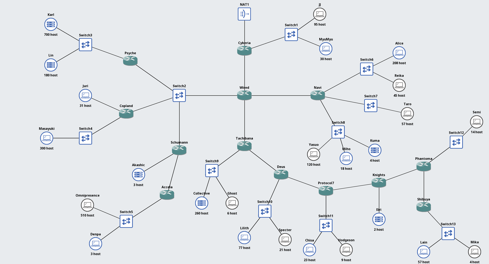

<br/>

| Router    | Adapter | eth0 menuju    | eth1 menuju    | eth2 menuju    | eth3 menuju |
| --------- | ------- | -------------- | -------------- | -------------- | ----------- |
| Cyberia   | 3       | NAT1           | Wired eth0     | Switch1        | —           |
| Wired     | 4       | Cyberia eth1   | Tachibana eth0 | Navi eth0      | Switch2     |
| Psyche    | 2       | Switch2        | Switch3        | —              | —           |
| Copland   | 3       | Switch2        | Juri eth0      | Switch4        | —           |
| Schumann  | 3       | Switch2        | Accela eth0    | Akashic eth0   | —           |
| Accela    | 2       | Schumann eth1  | Switch5        | —              | —           |
| Navi      | 4       | Wired eth2     | Switch6        | Switch7        | Switch8     |
| Tachibana | 3       | Wired eth1     | Deus eth0      | Switch9        | —           |
| Deus      | 3       | Tachibana eth1 | Switch10       | Protocol7 eth0 | —           |
| Protocol7 | 3       | Deus eth2      | Knights eth0   | Switch11       | —           |
| Knights   | 3       | Protocol7 eth1 | Eiri eth0      | Phantoma eth0  | —           |
| Phantoma  | 3       | Knights eth2   | Switch12       | Shibuya eth0   | —           |
| Shibuya   | 2       | Phantoma eth2  | Switch13       | —              | —           |

| Switch   | Anggota                          |
| -------- | -------------------------------- |
| Switch1  | Cyberia, JJ, MyuMyu              |
| Switch2  | Wired, Psyche, Copland, Schumann |
| Switch3  | Psyche, Karl, Lin                |
| Switch4  | Copland, Masayuki                |
| Switch5  | Accela, Omnipresence, Denpa      |
| Switch6  | Navi, Alice, Reika               |
| Switch7  | Navi, Taro                       |
| Switch8  | Navi, Yasuo, Miho, Kuma          |
| Switch9  | Tachibana, Collective, Ghost     |
| Switch10 | Deus, Lilith, Specter            |
| Switch11 | Protocol7, Chisa, Hodgeson       |
| Switch12 | Phantoma, Semi                   |
| Switch13 | Shibuya, Lain, Mika              |

<br/>

## Kebutuhan Subnet

| ID  | Segmen                                  | Perhitungan | Kebutuhan usable | Network           | Kapasitas usable |
| --- | --------------------------------------- | ----------- | ---------------- | ----------------- | ---------------- |
| A1  | Cyberia–JJ–MyuMyu                       | 95+30+1     | 126              | 192.230.64.0/25   | 126              |
| A2  | Cyberia–Wired                           | 2           | 2                | 192.230.64.128/30 | 2                |
| A3  | Wired–Psyche–Copland–Schumann (Switch2) | 4           | 4                | 192.230.22.64/29  | 6                |
| A4  | Psyche–Karl–Lin                         | 700+180+1   | 881              | 192.230.16.0/22   | 1022             |
| A5  | Copland–Juri                            | 31+1        | 32               | 192.230.22.0/26   | 62               |
| A6  | Copland–Masayuki                        | 300+1       | 301              | 192.230.20.0/23   | 510              |
| A7  | Schumann–Akashic                        | 3+1         | 4                | 192.230.8.0/29    | 6                |
| A8  | Schumann–Accela                         | 2           | 2                | 192.230.4.0/30    | 2                |
| A9  | Accela–Omnipresence–Denpa               | 510+3+1     | 514              | 192.230.0.0/22    | 1022             |
| A10 | Wired–Navi                              | 2           | 2                | 192.230.50.64/30  | 2                |
| A11 | Navi–Alice–Reika                        | 208+45+1    | 254              | 192.230.48.0/24   | 254              |
| A12 | Navi–Taro                               | 57+1        | 58               | 192.230.50.0/26   | 62               |
| A13 | Navi–Yasuo–Miho–Kuma                    | 120+18+4+1  | 143              | 192.230.49.0/24   | 254              |
| A14 | Wired–Tachibana                         | 2           | 2                | 192.230.42.0/30   | 2                |
| A15 | Tachibana–Collective–Ghost              | 260+6+1     | 267              | 192.230.40.0/23   | 510              |
| A16 | Tachibana–Deus                          | 2           | 2                | 192.230.36.128/30 | 2                |
| A17 | Deus–Lilith–Specter                     | 77+21+1     | 99               | 192.230.36.0/25   | 126              |
| A18 | Deus–Protocol7                          | 2           | 2                | 192.230.34.64/30  | 2                |
| A19 | Protocol7–Chisa–Hodgeson                | 23+9+1      | 33               | 192.230.34.0/26   | 62               |
| A20 | Protocol7–Knights                       | 2           | 2                | 192.230.33.8/30   | 2                |
| A21 | Knights–Eiri                            | 2+1         | 3                | 192.230.33.0/29   | 6                |
| A22 | Knights–Phantoma                        | 2           | 2                | 192.230.32.160/30 | 2                |
| A23 | Phantoma–Semi                           | 14+1        | 15               | 192.230.32.128/27 | 30               |
| A24 | Phantoma–Shibuya                        | 2           | 2                | 192.230.32.64/30  | 2                |
| A25 | Shibuya–Lain–Mika                       | 57+4+1      | 62               | 192.230.32.0/26   | 62               |

Total kebutuhan usable: **2814** <br/>
Total blok subnet awal: **4188 alamat** <br/><br/>

## Penggabungan CIDR

Penggabungan mengikuti cabang dari bawah ke pusat. Pada metode praktikum ini, prefix induk = min(prefix anak) - 1. Terdapat 24 penggabungan dengan kedalaman maksimum sembilan tahap. Nomor C adalah identitas agregat, bukan urutan alamat. Subnet fisik tetap A1–A25.

### Tahap 1

| Agregat | Anak 1  | Anak 2  | Hasil             | Rentang                         |
| ------- | ------- | ------- | ----------------- | ------------------------------- |
| C1      | A25 /26 | A24 /30 | 192.230.32.0/25   | 192.230.32.0 – 192.230.32.127   |
| C2      | A23 /27 | A22 /30 | 192.230.32.128/26 | 192.230.32.128 – 192.230.32.191 |
| C4      | A21 /29 | A20 /30 | 192.230.33.0/28   | 192.230.33.0 – 192.230.33.15    |
| C6      | A19 /26 | A18 /30 | 192.230.34.0/25   | 192.230.34.0 – 192.230.34.127   |
| C8      | A17 /25 | A16 /30 | 192.230.36.0/24   | 192.230.36.0 – 192.230.36.255   |
| C10     | A15 /23 | A14 /30 | 192.230.40.0/22   | 192.230.40.0 – 192.230.43.255   |
| C12     | A11 /24 | A13 /24 | 192.230.48.0/23   | 192.230.48.0 – 192.230.49.255   |
| C13     | A12 /26 | A10 /30 | 192.230.50.0/25   | 192.230.50.0 – 192.230.50.127   |
| C15     | A9 /22  | A8 /30  | 192.230.0.0/21    | 192.230.0.0 – 192.230.7.255     |
| C17     | A5 /26  | A3 /29  | 192.230.22.0/25   | 192.230.22.0 – 192.230.22.127   |
| C23     | A1 /25  | A2 /30  | 192.230.64.0/24   | 192.230.64.0 – 192.230.64.255   |

### Tahap 2

| Agregat | Anak 1  | Anak 2  | Hasil           | Rentang                       |
| ------- | ------- | ------- | --------------- | ----------------------------- |
| C3      | C1 /25  | C2 /26  | 192.230.32.0/24 | 192.230.32.0 – 192.230.32.255 |
| C14     | C12 /23 | C13 /25 | 192.230.48.0/22 | 192.230.48.0 – 192.230.51.255 |
| C16     | C15 /21 | A7 /29  | 192.230.0.0/20  | 192.230.0.0 – 192.230.15.255  |
| C18     | A6 /23  | C17 /25 | 192.230.20.0/22 | 192.230.20.0 – 192.230.23.255 |

### Tahap 3

| Agregat | Anak 1 | Anak 2  | Hasil           | Rentang                       |
| ------- | ------ | ------- | --------------- | ----------------------------- |
| C5      | C3 /24 | C4 /28  | 192.230.32.0/23 | 192.230.32.0 – 192.230.33.255 |
| C19     | A4 /22 | C18 /22 | 192.230.16.0/21 | 192.230.16.0 – 192.230.23.255 |

### Tahap 4

| Agregat | Anak 1  | Anak 2  | Hasil           | Rentang                       |
| ------- | ------- | ------- | --------------- | ----------------------------- |
| C7      | C5 /23  | C6 /25  | 192.230.32.0/22 | 192.230.32.0 – 192.230.35.255 |
| C20     | C16 /20 | C19 /21 | 192.230.0.0/19  | 192.230.0.0 – 192.230.31.255  |

### Tahap 5

| Agregat | Anak 1 | Anak 2 | Hasil           | Rentang                       |
| ------- | ------ | ------ | --------------- | ----------------------------- |
| C9      | C7 /22 | C8 /24 | 192.230.32.0/21 | 192.230.32.0 – 192.230.39.255 |

### Tahap 6

| Agregat | Anak 1 | Anak 2  | Hasil           | Rentang                       |
| ------- | ------ | ------- | --------------- | ----------------------------- |
| C11     | C9 /21 | C10 /22 | 192.230.32.0/20 | 192.230.32.0 – 192.230.47.255 |

### Tahap 7

| Agregat | Anak 1  | Anak 2  | Hasil           | Rentang                       |
| ------- | ------- | ------- | --------------- | ----------------------------- |
| C21     | C11 /20 | C14 /22 | 192.230.32.0/19 | 192.230.32.0 – 192.230.63.255 |

### Tahap 8

| Agregat | Anak 1  | Anak 2  | Hasil          | Rentang                      |
| ------- | ------- | ------- | -------------- | ---------------------------- |
| C22     | C20 /19 | C21 /19 | 192.230.0.0/18 | 192.230.0.0 – 192.230.63.255 |

### Tahap 9

| Agregat | Anak 1  | Anak 2  | Hasil          | Rentang                       |
| ------- | ------- | ------- | -------------- | ----------------------------- |
| C24     | C22 /18 | C23 /24 | 192.230.0.0/17 | 192.230.0.0 – 192.230.127.255 |

## Pembagian Alamat IP

| ID  | Network/prefix    | Netmask         | IP usable pertama | IP usable terakhir | Broadcast      |
| --- | ----------------- | --------------- | ----------------- | ------------------ | -------------- |
| A1  | 192.230.64.0/25   | 255.255.255.128 | 192.230.64.1      | 192.230.64.126     | 192.230.64.127 |
| A2  | 192.230.64.128/30 | 255.255.255.252 | 192.230.64.129    | 192.230.64.130     | 192.230.64.131 |
| A3  | 192.230.22.64/29  | 255.255.255.248 | 192.230.22.65     | 192.230.22.70      | 192.230.22.71  |
| A4  | 192.230.16.0/22   | 255.255.252.0   | 192.230.16.1      | 192.230.19.254     | 192.230.19.255 |
| A5  | 192.230.22.0/26   | 255.255.255.192 | 192.230.22.1      | 192.230.22.62      | 192.230.22.63  |
| A6  | 192.230.20.0/23   | 255.255.254.0   | 192.230.20.1      | 192.230.21.254     | 192.230.21.255 |
| A7  | 192.230.8.0/29    | 255.255.255.248 | 192.230.8.1       | 192.230.8.6        | 192.230.8.7    |
| A8  | 192.230.4.0/30    | 255.255.255.252 | 192.230.4.1       | 192.230.4.2        | 192.230.4.3    |
| A9  | 192.230.0.0/22    | 255.255.252.0   | 192.230.0.1       | 192.230.3.254      | 192.230.3.255  |
| A10 | 192.230.50.64/30  | 255.255.255.252 | 192.230.50.65     | 192.230.50.66      | 192.230.50.67  |
| A11 | 192.230.48.0/24   | 255.255.255.0   | 192.230.48.1      | 192.230.48.254     | 192.230.48.255 |
| A12 | 192.230.50.0/26   | 255.255.255.192 | 192.230.50.1      | 192.230.50.62      | 192.230.50.63  |
| A13 | 192.230.49.0/24   | 255.255.255.0   | 192.230.49.1      | 192.230.49.254     | 192.230.49.255 |
| A14 | 192.230.42.0/30   | 255.255.255.252 | 192.230.42.1      | 192.230.42.2       | 192.230.42.3   |
| A15 | 192.230.40.0/23   | 255.255.254.0   | 192.230.40.1      | 192.230.41.254     | 192.230.41.255 |
| A16 | 192.230.36.128/30 | 255.255.255.252 | 192.230.36.129    | 192.230.36.130     | 192.230.36.131 |
| A17 | 192.230.36.0/25   | 255.255.255.128 | 192.230.36.1      | 192.230.36.126     | 192.230.36.127 |
| A18 | 192.230.34.64/30  | 255.255.255.252 | 192.230.34.65     | 192.230.34.66      | 192.230.34.67  |
| A19 | 192.230.34.0/26   | 255.255.255.192 | 192.230.34.1      | 192.230.34.62      | 192.230.34.63  |
| A20 | 192.230.33.8/30   | 255.255.255.252 | 192.230.33.9      | 192.230.33.10      | 192.230.33.11  |
| A21 | 192.230.33.0/29   | 255.255.255.248 | 192.230.33.1      | 192.230.33.6       | 192.230.33.7   |
| A22 | 192.230.32.160/30 | 255.255.255.252 | 192.230.32.161    | 192.230.32.162     | 192.230.32.163 |
| A23 | 192.230.32.128/27 | 255.255.255.224 | 192.230.32.129    | 192.230.32.158     | 192.230.32.159 |
| A24 | 192.230.32.64/30  | 255.255.255.252 | 192.230.32.65     | 192.230.32.66      | 192.230.32.67  |
| A25 | 192.230.32.0/26   | 255.255.255.192 | 192.230.32.1      | 192.230.32.62      | 192.230.32.63  |

## Interface router

| Router    | eth0              | eth1              | eth2              | eth3             |
| --------- | ----------------- | ----------------- | ----------------- | ---------------- |
| Cyberia   | DHCP NAT          | 192.230.64.129/30 | 192.230.64.1/25   | —                |
| Wired     | 192.230.64.130/30 | 192.230.42.1/30   | 192.230.50.65/30  | 192.230.22.65/29 |
| Psyche    | 192.230.22.66/29  | 192.230.16.1/22   | —                 | —                |
| Copland   | 192.230.22.67/29  | 192.230.22.1/26   | 192.230.20.1/23   | —                |
| Schumann  | 192.230.22.68/29  | 192.230.4.1/30    | 192.230.8.1/29    | —                |
| Accela    | 192.230.4.2/30    | 192.230.0.1/22    | —                 | —                |
| Navi      | 192.230.50.66/30  | 192.230.48.1/24   | 192.230.50.1/26   | 192.230.49.1/24  |
| Tachibana | 192.230.42.2/30   | 192.230.36.129/30 | 192.230.40.1/23   | —                |
| Deus      | 192.230.36.130/30 | 192.230.36.1/25   | 192.230.34.65/30  | —                |
| Protocol7 | 192.230.34.66/30  | 192.230.33.9/30   | 192.230.34.1/26   | —                |
| Knights   | 192.230.33.10/30  | 192.230.33.1/29   | 192.230.32.161/30 | —                |
| Phantoma  | 192.230.32.162/30 | 192.230.32.129/27 | 192.230.32.65/30  | —                |
| Shibuya   | 192.230.32.66/30  | 192.230.32.1/26   | —                 | —                |

## Endpoint

| Node         | IP/prefix         | Gateway        |
| ------------ | ----------------- | -------------- |
| JJ           | 192.230.64.2/25   | 192.230.64.1   |
| MyuMyu       | 192.230.64.3/25   | 192.230.64.1   |
| Karl         | 192.230.16.2/22   | 192.230.16.1   |
| Lin          | 192.230.16.3/22   | 192.230.16.1   |
| Juri         | 192.230.22.2/26   | 192.230.22.1   |
| Masayuki     | 192.230.20.2/23   | 192.230.20.1   |
| Akashic      | 192.230.8.2/29    | 192.230.8.1    |
| Omnipresence | 192.230.0.2/22    | 192.230.0.1    |
| Denpa        | 192.230.0.3/22    | 192.230.0.1    |
| Alice        | 192.230.48.2/24   | 192.230.48.1   |
| Reika        | 192.230.48.3/24   | 192.230.48.1   |
| Taro         | 192.230.50.2/26   | 192.230.50.1   |
| Yasuo        | 192.230.49.2/24   | 192.230.49.1   |
| Miho         | 192.230.49.3/24   | 192.230.49.1   |
| Kuma         | 192.230.49.4/24   | 192.230.49.1   |
| Collective   | 192.230.40.2/23   | 192.230.40.1   |
| Ghost        | 192.230.40.3/23   | 192.230.40.1   |
| Lilith       | 192.230.36.2/25   | 192.230.36.1   |
| Specter      | 192.230.36.3/25   | 192.230.36.1   |
| Chisa        | 192.230.34.2/26   | 192.230.34.1   |
| Hodgeson     | 192.230.34.3/26   | 192.230.34.1   |
| Eiri         | 192.230.33.2/29   | 192.230.33.1   |
| Semi         | 192.230.32.130/27 | 192.230.32.129 |
| Lain         | 192.230.32.2/26   | 192.230.32.1   |
| Mika         | 192.230.32.3/26   | 192.230.32.1   |

## Static routing

| Router    | Default gateway | Tujuan → next hop                                                                                                                                                         | Blackhole       |
| --------- | --------------- | ------------------------------------------------------------------------------------------------------------------------------------------------------------------------- | --------------- |
| Cyberia   | DHCP NAT        | 192.230.0.0/18 → 192.230.64.130                                                                                                                                           | 192.230.0.0/17  |
| Wired     | 192.230.64.129  | 192.230.16.0/22 → 192.230.22.66<br>192.230.20.0/22 → 192.230.22.67<br>192.230.0.0/20 → 192.230.22.68<br>192.230.48.0/22 → 192.230.50.66<br>192.230.32.0/20 → 192.230.42.2 | 192.230.0.0/18  |
| Psyche    | 192.230.22.65   | —                                                                                                                                                                         | —               |
| Copland   | 192.230.22.65   | —                                                                                                                                                                         | 192.230.20.0/22 |
| Schumann  | 192.230.22.65   | 192.230.0.0/22 → 192.230.4.2                                                                                                                                              | 192.230.0.0/20  |
| Accela    | 192.230.4.1     | —                                                                                                                                                                         | —               |
| Navi      | 192.230.50.65   | —                                                                                                                                                                         | 192.230.48.0/22 |
| Tachibana | 192.230.42.1    | 192.230.32.0/21 → 192.230.36.130                                                                                                                                          | 192.230.32.0/20 |
| Deus      | 192.230.36.129  | 192.230.32.0/22 → 192.230.34.66                                                                                                                                           | 192.230.32.0/21 |
| Protocol7 | 192.230.34.65   | 192.230.32.0/23 → 192.230.33.10                                                                                                                                           | 192.230.32.0/22 |
| Knights   | 192.230.33.9    | 192.230.32.0/24 → 192.230.32.162                                                                                                                                          | 192.230.32.0/23 |
| Phantoma  | 192.230.32.161  | 192.230.32.0/26 → 192.230.32.66                                                                                                                                           | 192.230.32.0/24 |
| Shibuya   | 192.230.32.65   | —                                                                                                                                                                         | —               |

## GNS3 CIDR

| File                     | Penempatan                           |
| ------------------------ | ------------------------------------ |
| setup-router.sh          | /root pada semua router              |
| setup-client.sh          | /root pada semua endpoint            |
| test-all.sh              | /root pada semua router dan endpoint |
| nat.sh dan enable-wan.sh | /root pada Cyberia saja              |

Jalankan script setup-router.sh di semua router

```bash
sh setup-router.sh <router>
```

<br/>

| Console   | Setup                          | Tes tetangga               |
| --------- | ------------------------------ | -------------------------- |
| Cyberia   | `sh setup-router.sh Cyberia`   | Lanjut Wired               |
| Wired     | `sh setup-router.sh Wired`     | `ping -c 4 192.230.64.129` |
| Psyche    | `sh setup-router.sh Psyche`    | `ping -c 4 192.230.22.65`  |
| Copland   | `sh setup-router.sh Copland`   | `ping -c 4 192.230.22.65`  |
| Schumann  | `sh setup-router.sh Schumann`  | `ping -c 4 192.230.22.65`  |
| Accela    | `sh setup-router.sh Accela`    | `ping -c 4 192.230.4.1`    |
| Navi      | `sh setup-router.sh Navi`      | `ping -c 4 192.230.50.65`  |
| Tachibana | `sh setup-router.sh Tachibana` | `ping -c 4 192.230.42.1`   |
| Deus      | `sh setup-router.sh Deus`      | `ping -c 4 192.230.36.129` |
| Protocol7 | `sh setup-router.sh Protocol7` | `ping -c 4 192.230.34.65`  |
| Knights   | `sh setup-router.sh Knights`   | `ping -c 4 192.230.33.9`   |
| Phantoma  | `sh setup-router.sh Phantoma`  | `ping -c 4 192.230.32.161` |
| Shibuya   | `sh setup-router.sh Shibuya`   | `ping -c 4 192.230.32.65`  |

<br/>

#### Hasil setup router Cyberia

Hasil menjalankan `sh setup-router.sh Cyberia` menunjukkan alamat internal `eth1` = `192.230.64.129/30` dan `eth2` = `192.230.64.1/25`, route menuju `192.230.0.0/18` melalui Wired, serta IP forwarding bernilai `1`. Pada saat screenshot diambil, interface WAN `eth0` juga sudah memiliki alamat `192.168.122.53/24` dan aturan NAT berhasil diterapkan.

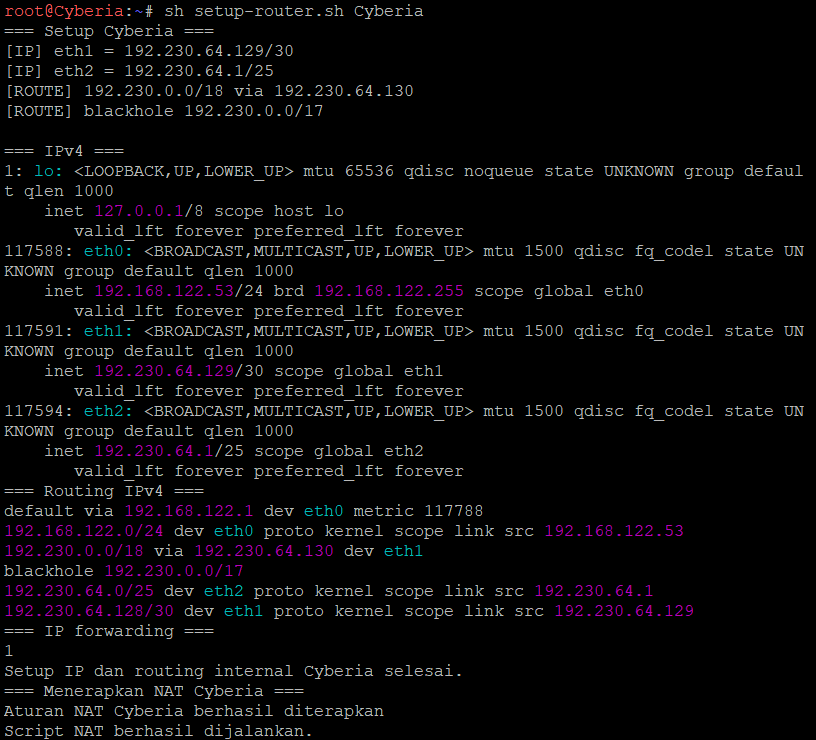

#### Router Test

Di router Cyberia

```sh
ping -c 4 192.230.0.1
ping -c 4 192.230.48.1
ping -c 4 192.230.32.1
```

Di router Shibuya:

```sh
ping -c 4 192.230.64.1
ping -c 4 192.230.16.1
```

<br/>

Jalankan setup-client.sh di semua endpoint

```bash
sh setup-client.sh <endpoint>
```

| Console      | Perintah                          |
| ------------ | --------------------------------- |
| JJ           | `sh setup-client.sh JJ`           |
| MyuMyu       | `sh setup-client.sh MyuMyu`       |
| Karl         | `sh setup-client.sh Karl`         |
| Lin          | `sh setup-client.sh Lin`          |
| Juri         | `sh setup-client.sh Juri`         |
| Masayuki     | `sh setup-client.sh Masayuki`     |
| Akashic      | `sh setup-client.sh Akashic`      |
| Omnipresence | `sh setup-client.sh Omnipresence` |
| Denpa        | `sh setup-client.sh Denpa`        |
| Alice        | `sh setup-client.sh Alice`        |
| Reika        | `sh setup-client.sh Reika`        |
| Taro         | `sh setup-client.sh Taro`         |
| Yasuo        | `sh setup-client.sh Yasuo`        |
| Miho         | `sh setup-client.sh Miho`         |
| Kuma         | `sh setup-client.sh Kuma`         |
| Collective   | `sh setup-client.sh Collective`   |
| Ghost        | `sh setup-client.sh Ghost`        |
| Lilith       | `sh setup-client.sh Lilith`       |
| Specter      | `sh setup-client.sh Specter`      |
| Chisa        | `sh setup-client.sh Chisa`        |
| Hodgeson     | `sh setup-client.sh Hodgeson`     |
| Eiri         | `sh setup-client.sh Eiri`         |
| Semi         | `sh setup-client.sh Semi`         |
| Lain         | `sh setup-client.sh Lain`         |
| Mika         | `sh setup-client.sh Mika`         |

#### Tes gateway dan koneksi antar-subnet dari JJ

Jalankan di console JJ:

```sh
# Gateway JJ pada Cyberia
ping -c 4 192.230.64.1

# Endpoint Karl pada subnet A4
ping -c 4 192.230.16.2

# Endpoint Lain pada subnet A25
ping -c 4 192.230.32.2
```

Ketiga tujuan membalas ping dengan **0% packet loss**. Hasil ini menunjukkan JJ dapat mencapai gateway serta endpoint pada cabang Psyche dan Shibuya. Screenshot yang sama juga memuat ping internet yang berhasil; hasil DNS lanjutannya ditampilkan pada bagian pengujian DNS JJ.

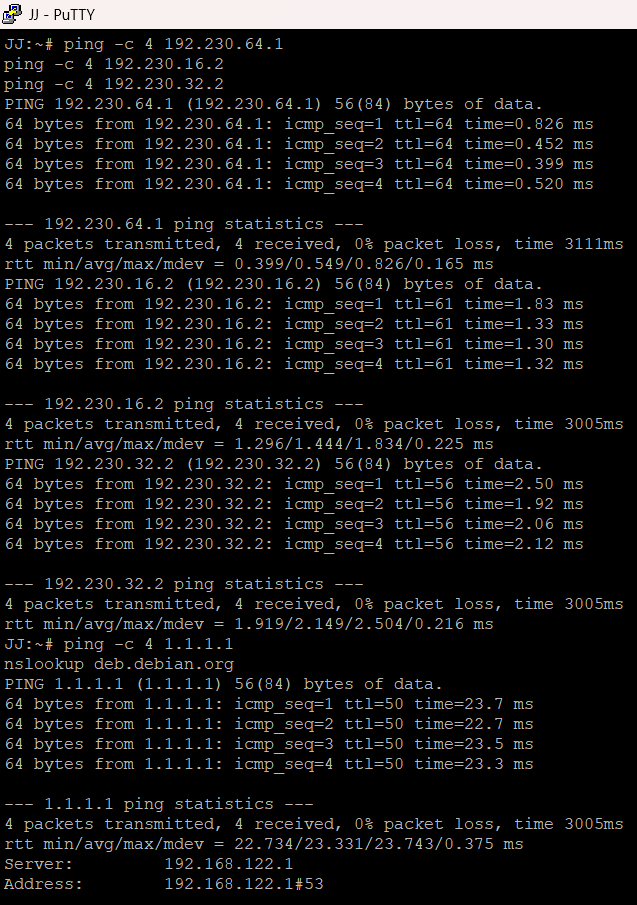

#### Pengujian 62 alamat IP internal dari Cyberia

Setelah seluruh router dan endpoint dikonfigurasi, jalankan di console Cyberia:

```sh
sh test-all.sh Cyberia > Cyberia-internal.csv
cat Cyberia-internal.csv
```

Ringkasan pengujian menunjukkan **PASS=62** dan **FAIL=0** untuk daftar target internal dari Cyberia.

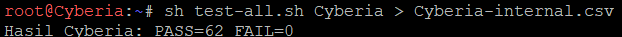

Berikut cuplikan isi CSV yang mencatat sumber, target, alamat IP, dan status pengujian. Screenshot detail hanya menampilkan sebagian baris CSV; jumlah keseluruhan hasil terlihat pada ringkasan di atas. Pengujian ini menggunakan Cyberia sebagai sumber, sehingga hasilnya tidak mewakili pengujian setiap pasangan node.

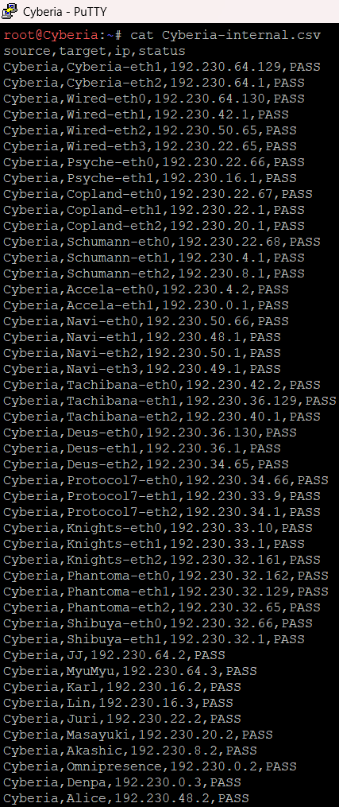

#### Pemeriksaan IP WAN dan default route Cyberia

Jalankan di console Cyberia:

```sh
ip -4 address show dev eth0
ip route show default
```

Pada saat pengujian, `eth0` memiliki IP `192.168.122.53/24` dan default route menuju gateway NAT `192.168.122.1`. Alamat WAN mengikuti jaringan NAT dan dapat berubah sesuai lease DHCP.

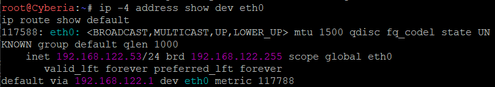

#### Tes gateway NAT dan internet dari Cyberia

Jalankan di console Cyberia:

```sh
# Gateway NAT
ping -c 4 192.168.122.1

# Alamat IP internet
ping -c 4 1.1.1.1
```

Kedua tujuan membalas seluruh paket dengan **0% packet loss**.

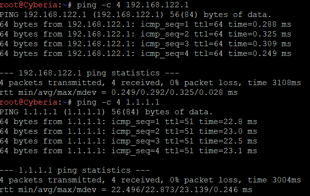

#### Tes DNS dari Cyberia

Jalankan di console Cyberia:

```sh
cat /etc/resolv.conf
getent ahostsv4 deb.debian.org
```

Resolver yang digunakan adalah `192.168.122.1`. Nama `deb.debian.org` berhasil diresolusikan menjadi alamat IPv4 `146.75.46.132` pada saat pengujian. Alamat hasil resolusi dapat berubah.

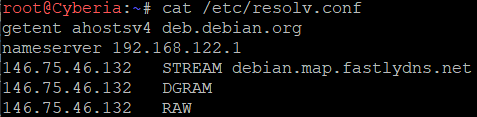

#### Penerapan NAT dan IP forwarding di Cyberia

Jalankan di console Cyberia:

```sh
sh nat.sh
cat /proc/sys/net/ipv4/ip_forward
iptables -t nat -L POSTROUTING -n -v
iptables -L FORWARD -n -v
```

IP forwarding bernilai **1**. Aturan `MASQUERADE` diterapkan untuk sumber `192.230.0.0/17` yang keluar melalui `eth0`. Tabel `FORWARD` juga memuat aturan untuk trafik keluar dari jaringan internal dan trafik balasan dengan status `RELATED,ESTABLISHED`.

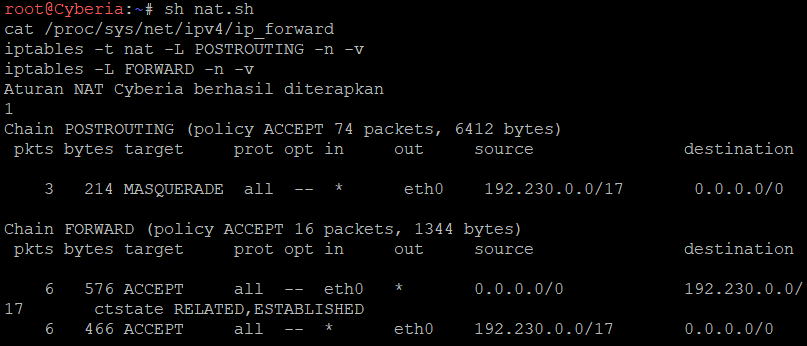

<details>
<summary>Screenshot tambahan verifikasi aturan NAT Cyberia</summary>

Screenshot berikut mendokumentasikan pemeriksaan ulang aturan NAT dan forwarding yang sama.

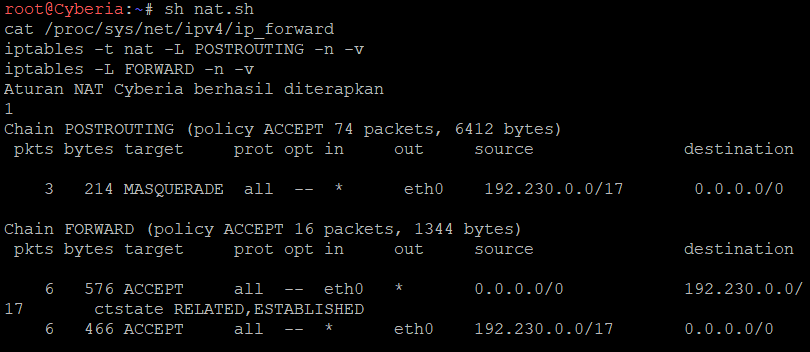

</details>

#### Tes gateway, internet, dan DNS dari JJ

Jalankan di console JJ:

```sh
# Gateway JJ, yaitu Cyberia
ping -c 4 192.230.64.1

# Akses internet melalui Cyberia
ping -c 4 1.1.1.1

# Resolusi DNS
nslookup deb.debian.org
```

Ping ke gateway dan internet berhasil dengan **0% packet loss**. Perintah `nslookup` juga memperoleh jawaban DNS melalui server `192.168.122.1`.

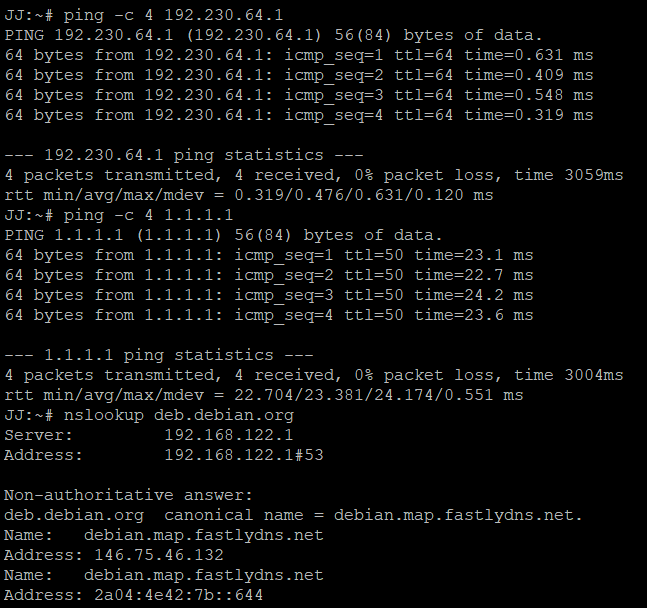

<details>
<summary>Hasil DNS lanjutan dari screenshot pengujian awal JJ</summary>

Gambar ini merupakan lanjutan keluaran `nslookup` pada screenshot pengujian antar-subnet JJ. Jawaban DNS memuat alias serta alamat IPv4 dan IPv6 tujuan.

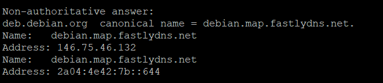

</details>

#### Verifikasi paket melewati NAT Cyberia

Setelah pengujian internet dari endpoint, periksa kembali counter NAT di console Cyberia:

```sh
iptables -t nat -L POSTROUTING -n -v
```

Counter aturan `MASQUERADE` pada screenshot ini menunjukkan **6 paket dan 428 byte**, dibandingkan **3 paket dan 214 byte** pada screenshot konfigurasi NAT sebelumnya. Kenaikan counter menunjukkan ada paket tambahan yang cocok dengan aturan NAT. Counter tabel NAT tidak menghitung seluruh paket dari setiap koneksi.

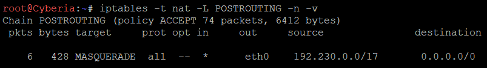

### VLSM

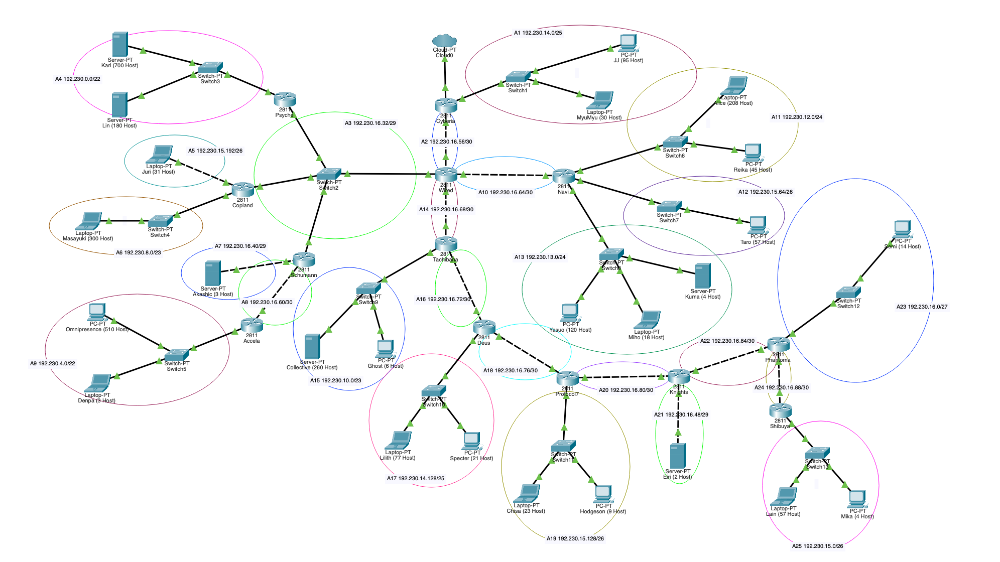

## Hasil Subnetting

| No  | Subnet | Rute                                        | Jumlah IP | Blok | Prefix | Network        | Subnet Mask     | Range Host                      | Broadcast      |
| --- | ------ | ------------------------------------------- | --------- | ---- | ------ | -------------- | --------------- | ------------------------------- | -------------- |
| 1   | A4     | Psyche > Switch3 > Karl, Lin                | 881       | 1024 | /22    | 192.230.0.0    | 255.255.252.0   | 192.230.0.1 - 192.230.3.254     | 192.230.3.255  |
| 2   | A9     | Accela > Switch5 > Omnipresence, Denpa      | 514       | 1024 | /22    | 192.230.4.0    | 255.255.252.0   | 192.230.4.1 - 192.230.7.254     | 192.230.7.255  |
| 3   | A6     | Copland > Switch4 > Masayuki                | 301       | 512  | /23    | 192.230.8.0    | 255.255.254.0   | 192.230.8.1 - 192.230.9.254     | 192.230.9.255  |
| 4   | A15    | Tachibana > Switch9 > Collective, Ghost     | 267       | 512  | /23    | 192.230.10.0   | 255.255.254.0   | 192.230.10.1 - 192.230.11.254   | 192.230.11.255 |
| 5   | A11    | Navi > Switch6 > Alice, Reika               | 254       | 256  | /24    | 192.230.12.0   | 255.255.255.0   | 192.230.12.1 - 192.230.12.254   | 192.230.12.255 |
| 6   | A13    | Navi > Switch8 > Yasuo, Miho, Kuma          | 143       | 256  | /24    | 192.230.13.0   | 255.255.255.0   | 192.230.13.1 - 192.230.13.254   | 192.230.13.255 |
| 7   | A1     | Cyberia > Switch1 > JJ, MyuMyu              | 126       | 128  | /25    | 192.230.14.0   | 255.255.255.128 | 192.230.14.1 - 192.230.14.126   | 192.230.14.127 |
| 8   | A17    | Deus > Switch10 > Lilith, Specter           | 99        | 128  | /25    | 192.230.14.128 | 255.255.255.128 | 192.230.14.129 - 192.230.14.254 | 192.230.14.255 |
| 9   | A25    | Shibuya > Switch13 > Lain, Mika             | 62        | 64   | /26    | 192.230.15.0   | 255.255.255.192 | 192.230.15.1 - 192.230.15.62    | 192.230.15.63  |
| 10  | A12    | Navi > Switch7 > Taro                       | 58        | 64   | /26    | 192.230.15.64  | 255.255.255.192 | 192.230.15.65 - 192.230.15.126  | 192.230.15.127 |
| 11  | A19    | Protocol7 > Switch11 > Chisa, Hodgeson      | 33        | 64   | /26    | 192.230.15.128 | 255.255.255.192 | 192.230.15.129 - 192.230.15.190 | 192.230.15.191 |
| 12  | A5     | Copland > Juri                              | 32        | 64   | /26    | 192.230.15.192 | 255.255.255.192 | 192.230.15.193 - 192.230.15.254 | 192.230.15.255 |
| 13  | A23    | Phantoma > Switch12 > Semi                  | 15        | 32   | /27    | 192.230.16.0   | 255.255.255.224 | 192.230.16.1 - 192.230.16.30    | 192.230.16.31  |
| 14  | A3     | Wired > Switch2 > Psyche, Copland, Schumann | 4         | 8    | /29    | 192.230.16.32  | 255.255.255.248 | 192.230.16.33 - 192.230.16.38   | 192.230.16.39  |
| 15  | A7     | Schumann > Akashic                          | 4         | 8    | /29    | 192.230.16.40  | 255.255.255.248 | 192.230.16.41 - 192.230.16.46   | 192.230.16.47  |
| 16  | A21    | Knights > Eiri                              | 3         | 8    | /29    | 192.230.16.48  | 255.255.255.248 | 192.230.16.49 - 192.230.16.54   | 192.230.16.55  |
| 17  | A2     | Cyberia > Wired                             | 2         | 4    | /30    | 192.230.16.56  | 255.255.255.252 | 192.230.16.57 - 192.230.16.58   | 192.230.16.59  |
| 18  | A8     | Schumann > Accela                           | 2         | 4    | /30    | 192.230.16.60  | 255.255.255.252 | 192.230.16.61 - 192.230.16.62   | 192.230.16.63  |
| 19  | A10    | Wired > Navi                                | 2         | 4    | /30    | 192.230.16.64  | 255.255.255.252 | 192.230.16.65 - 192.230.16.66   | 192.230.16.67  |
| 20  | A14    | Wired > Tachibana                           | 2         | 4    | /30    | 192.230.16.68  | 255.255.255.252 | 192.230.16.69 - 192.230.16.70   | 192.230.16.71  |
| 21  | A16    | Tachibana > Deus                            | 2         | 4    | /30    | 192.230.16.72  | 255.255.255.252 | 192.230.16.73 - 192.230.16.74   | 192.230.16.75  |
| 22  | A18    | Deus > Protocol7                            | 2         | 4    | /30    | 192.230.16.76  | 255.255.255.252 | 192.230.16.77 - 192.230.16.78   | 192.230.16.79  |
| 23  | A20    | Protocol7 > Knights                         | 2         | 4    | /30    | 192.230.16.80  | 255.255.255.252 | 192.230.16.81 - 192.230.16.82   | 192.230.16.83  |
| 24  | A22    | Knights > Phantoma                          | 2         | 4    | /30    | 192.230.16.84  | 255.255.255.252 | 192.230.16.85 - 192.230.16.86   | 192.230.16.87  |
| 25  | A24    | Phantoma > Shibuya                          | 2         | 4    | /30    | 192.230.16.88  | 255.255.255.252 | 192.230.16.89 - 192.230.16.90   | 192.230.16.91  |

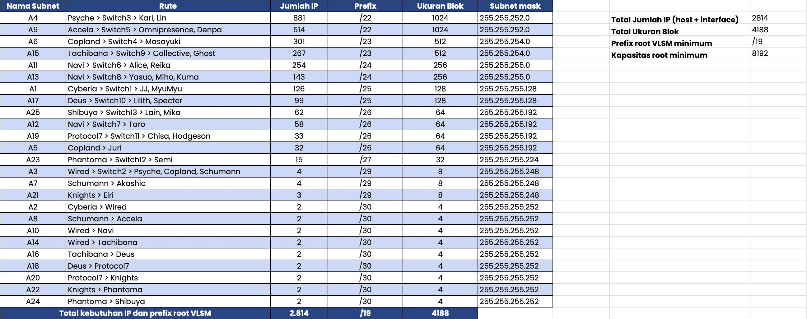

## Pohon Pembagian IP

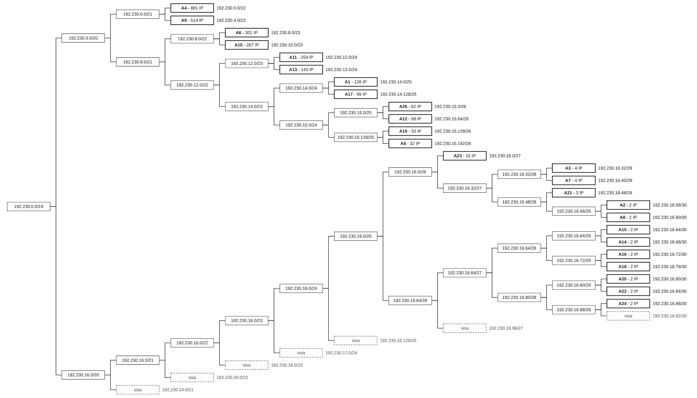

```
192.230.0.0/19  (root, 4188 alamat terpakai dari 8192)
  +- 192.230.0.0/22  A4  (881 IP, blok 1024)
  +- 192.230.4.0/22  A9  (514 IP, blok 1024)
  +- 192.230.8.0/23  A6  (301 IP, blok 512)
  +- 192.230.10.0/23  A15  (267 IP, blok 512)
  +- 192.230.12.0/24  A11  (254 IP, blok 256)
  +- 192.230.13.0/24  A13  (143 IP, blok 256)
  +- 192.230.14.0/25  A1  (126 IP, blok 128)
  +- 192.230.14.128/25  A17  (99 IP, blok 128)
  +- 192.230.15.0/26  A25  (62 IP, blok 64)
  +- 192.230.15.64/26  A12  (58 IP, blok 64)
  +- 192.230.15.128/26  A19  (33 IP, blok 64)
  +- 192.230.15.192/26  A5  (32 IP, blok 64)
  +- 192.230.16.0/27  A23  (15 IP, blok 32)
  +- 192.230.16.32/29  A3  (4 IP, blok 8)
  +- 192.230.16.40/29  A7  (4 IP, blok 8)
  +- 192.230.16.48/29  A21  (3 IP, blok 8)
  +- 192.230.16.56/30  A2  (2 IP, blok 4)
  +- 192.230.16.60/30  A8  (2 IP, blok 4)
  +- 192.230.16.64/30  A10  (2 IP, blok 4)
  +- 192.230.16.68/30  A14  (2 IP, blok 4)
  +- 192.230.16.72/30  A16  (2 IP, blok 4)
  +- 192.230.16.76/30  A18  (2 IP, blok 4)
  +- 192.230.16.80/30  A20  (2 IP, blok 4)
  +- 192.230.16.84/30  A22  (2 IP, blok 4)
  +- 192.230.16.88/30  A24  (2 IP, blok 4)
```

Sisa alamat di dalam /19: 192.230.16.92 sampai 192.230.31.255 belum terpakai. Sisa ini ada di **belakang** alokasi dan bisa dipakai jika topologi bertambah.

## Konfigurasi Interface Router

Port mengikuti kabel yang benar-benar terpasang di file `.pkt`. Semua interface dalam keadaan `no shutdown`.

### Cyberia

| Port            | Subnet | IP Address    | Subnet Mask     | Terhubung ke         |
| --------------- | ------ | ------------- | --------------- | -------------------- |
| FastEthernet0/0 | -      | (tanpa IP)    | -               | Cloud                |
| FastEthernet0/1 | A2     | 192.230.16.57 | 255.255.255.252 | Wired                |
| FastEthernet1/0 | A1     | 192.230.14.1  | 255.255.255.128 | Switch1 (JJ, MyuMyu) |

### Wired

| Port            | Subnet | IP Address    | Subnet Mask     | Terhubung ke              |
| --------------- | ------ | ------------- | --------------- | ------------------------- |
| FastEthernet0/0 | A2     | 192.230.16.58 | 255.255.255.252 | Cyberia                   |
| FastEthernet0/1 | A14    | 192.230.16.69 | 255.255.255.252 | Tachibana                 |
| FastEthernet1/0 | A10    | 192.230.16.65 | 255.255.255.252 | Navi                      |
| FastEthernet1/1 | A3     | 192.230.16.33 | 255.255.255.248 | Psyche, Copland, Schumann |

### Navi

| Port            | Subnet | IP Address    | Subnet Mask     | Terhubung ke                |
| --------------- | ------ | ------------- | --------------- | --------------------------- |
| FastEthernet0/0 | A10    | 192.230.16.66 | 255.255.255.252 | Wired                       |
| FastEthernet0/1 | A11    | 192.230.12.1  | 255.255.255.0   | Switch6 (Alice, Reika)      |
| FastEthernet1/0 | A12    | 192.230.15.65 | 255.255.255.192 | Switch7 (Taro)              |
| FastEthernet1/1 | A13    | 192.230.13.1  | 255.255.255.0   | Switch8 (Yasuo, Miho, Kuma) |

### Tachibana

| Port            | Subnet | IP Address    | Subnet Mask     | Terhubung ke                |
| --------------- | ------ | ------------- | --------------- | --------------------------- |
| FastEthernet0/0 | A14    | 192.230.16.70 | 255.255.255.252 | Wired                       |
| FastEthernet0/1 | A15    | 192.230.10.1  | 255.255.254.0   | Switch9 (Collective, Ghost) |
| FastEthernet1/0 | A16    | 192.230.16.73 | 255.255.255.252 | Deus                        |

### Psyche

| Port            | Subnet | IP Address    | Subnet Mask     | Terhubung ke             |
| --------------- | ------ | ------------- | --------------- | ------------------------ |
| FastEthernet0/0 | A3     | 192.230.16.34 | 255.255.255.248 | Wired, Copland, Schumann |
| FastEthernet0/1 | A4     | 192.230.0.1   | 255.255.252.0   | Switch3 (Karl, Lin)      |

### Copland

| Port            | Subnet | IP Address     | Subnet Mask     | Terhubung ke            |
| --------------- | ------ | -------------- | --------------- | ----------------------- |
| FastEthernet0/0 | A3     | 192.230.16.35  | 255.255.255.248 | Wired, Psyche, Schumann |
| FastEthernet0/1 | A5     | 192.230.15.193 | 255.255.255.192 | Juri                    |
| FastEthernet1/0 | A6     | 192.230.8.1    | 255.255.254.0   | Switch4 (Masayuki)      |

### Schumann

| Port            | Subnet | IP Address    | Subnet Mask     | Terhubung ke           |
| --------------- | ------ | ------------- | --------------- | ---------------------- |
| FastEthernet0/0 | A3     | 192.230.16.36 | 255.255.255.248 | Wired, Psyche, Copland |
| FastEthernet0/1 | A7     | 192.230.16.41 | 255.255.255.248 | Akashic                |
| FastEthernet1/0 | A8     | 192.230.16.61 | 255.255.255.252 | Accela                 |

### Accela

| Port            | Subnet | IP Address    | Subnet Mask     | Terhubung ke                  |
| --------------- | ------ | ------------- | --------------- | ----------------------------- |
| FastEthernet0/0 | A8     | 192.230.16.62 | 255.255.255.252 | Schumann                      |
| FastEthernet0/1 | A9     | 192.230.4.1   | 255.255.252.0   | Switch5 (Omnipresence, Denpa) |

### Deus

| Port            | Subnet | IP Address     | Subnet Mask     | Terhubung ke               |
| --------------- | ------ | -------------- | --------------- | -------------------------- |
| FastEthernet0/0 | A16    | 192.230.16.74  | 255.255.255.252 | Tachibana                  |
| FastEthernet0/1 | A18    | 192.230.16.77  | 255.255.255.252 | Protocol7                  |
| FastEthernet1/0 | A17    | 192.230.14.129 | 255.255.255.128 | Switch10 (Lilith, Specter) |

### Protocol7

| Port            | Subnet | IP Address     | Subnet Mask     | Terhubung ke               |
| --------------- | ------ | -------------- | --------------- | -------------------------- |
| FastEthernet0/0 | A18    | 192.230.16.78  | 255.255.255.252 | Deus                       |
| FastEthernet0/1 | A20    | 192.230.16.81  | 255.255.255.252 | Knights                    |
| FastEthernet1/0 | A19    | 192.230.15.129 | 255.255.255.192 | Switch11 (Chisa, Hodgeson) |

### Knights

| Port            | Subnet | IP Address    | Subnet Mask     | Terhubung ke |
| --------------- | ------ | ------------- | --------------- | ------------ |
| FastEthernet0/0 | A20    | 192.230.16.82 | 255.255.255.252 | Protocol7    |
| FastEthernet0/1 | A22    | 192.230.16.85 | 255.255.255.252 | Phantoma     |
| FastEthernet1/0 | A21    | 192.230.16.49 | 255.255.255.248 | Eiri         |

### Phantoma

| Port            | Subnet | IP Address    | Subnet Mask     | Terhubung ke    |
| --------------- | ------ | ------------- | --------------- | --------------- |
| FastEthernet0/0 | A22    | 192.230.16.86 | 255.255.255.252 | Knights         |
| FastEthernet0/1 | A23    | 192.230.16.1  | 255.255.255.224 | Switch12 (Semi) |
| FastEthernet1/0 | A24    | 192.230.16.89 | 255.255.255.252 | Shibuya         |

### Shibuya

| Port            | Subnet | IP Address    | Subnet Mask     | Terhubung ke          |
| --------------- | ------ | ------------- | --------------- | --------------------- |
| FastEthernet0/0 | A24    | 192.230.16.90 | 255.255.255.252 | Phantoma              |
| FastEthernet0/1 | A25    | 192.230.15.1  | 255.255.255.192 | Switch13 (Lain, Mika) |

## Konfigurasi Routing

Aturan routing yang dipakai:

- Tiap router anak punya **default route** ke router induknya, jadi semua tujuan yang tidak dikenal naik ke atas.
- Tiap router yang punya anak punya **route ringkasan** ke tiap anak, jadi alamat di bawah cabang itu turun ke bawah.
- Route ringkasan boleh mencakup subnet yang tersambung langsung ke router itu, karena _connected route_ lebih spesifik dan selalu menang.
- Default route Cyberia ke Cloud (exit interface) tidak dibuat karena Cloud di CPT tidak punya jaringan di belakangnya dan tidak memengaruhi koneksi antar-node.

### Cyberia (1 route)

| Network     | Mask          | Next Hop      | Keterangan                                                                                                           |
| ----------- | ------------- | ------------- | -------------------------------------------------------------------------------------------------------------------- |
| 192.230.0.0 | 255.255.224.0 | 192.230.16.58 | A3, A4, A5, A6, A7, A8, A9, A10, A11, A12, A13, A14, A15, A16, A17, A18, A19, A20, A21, A22, A23, A24, A25 via Wired |

### Wired (16 route)

| Network        | Mask            | Next Hop      | Keterangan                            |
| -------------- | --------------- | ------------- | ------------------------------------- |
| 0.0.0.0        | 0.0.0.0         | 192.230.16.57 | Default ke Cyberia                    |
| 192.230.12.0   | 255.255.254.0   | 192.230.16.66 | A11, A13 via Navi                     |
| 192.230.15.64  | 255.255.255.192 | 192.230.16.66 | A12 via Navi                          |
| 192.230.10.0   | 255.255.254.0   | 192.230.16.70 | A15 via Tachibana                     |
| 192.230.14.128 | 255.255.255.128 | 192.230.16.70 | A17 via Tachibana                     |
| 192.230.15.0   | 255.255.255.192 | 192.230.16.70 | A25 via Tachibana                     |
| 192.230.15.128 | 255.255.255.192 | 192.230.16.70 | A19 via Tachibana                     |
| 192.230.16.0   | 255.255.255.224 | 192.230.16.70 | A23 via Tachibana                     |
| 192.230.16.48  | 255.255.255.248 | 192.230.16.70 | A21 via Tachibana                     |
| 192.230.16.64  | 255.255.255.224 | 192.230.16.70 | A16, A18, A20, A22, A24 via Tachibana |
| 192.230.0.0    | 255.255.252.0   | 192.230.16.34 | A4 via Psyche                         |
| 192.230.8.0    | 255.255.254.0   | 192.230.16.35 | A6 via Copland                        |
| 192.230.15.192 | 255.255.255.192 | 192.230.16.35 | A5 via Copland                        |
| 192.230.4.0    | 255.255.252.0   | 192.230.16.36 | A9 via Schumann                       |
| 192.230.16.40  | 255.255.255.248 | 192.230.16.36 | A7 via Schumann                       |
| 192.230.16.60  | 255.255.255.252 | 192.230.16.36 | A8 via Schumann                       |

### Navi (1 route)

| Network | Mask    | Next Hop      | Keterangan       |
| ------- | ------- | ------------- | ---------------- |
| 0.0.0.0 | 0.0.0.0 | 192.230.16.65 | Default ke Wired |

### Tachibana (8 route)

| Network        | Mask            | Next Hop      | Keterangan             |
| -------------- | --------------- | ------------- | ---------------------- |
| 0.0.0.0        | 0.0.0.0         | 192.230.16.69 | Default ke Wired       |
| 192.230.14.128 | 255.255.255.128 | 192.230.16.74 | A17 via Deus           |
| 192.230.15.0   | 255.255.255.192 | 192.230.16.74 | A25 via Deus           |
| 192.230.15.128 | 255.255.255.192 | 192.230.16.74 | A19 via Deus           |
| 192.230.16.0   | 255.255.255.224 | 192.230.16.74 | A23 via Deus           |
| 192.230.16.48  | 255.255.255.248 | 192.230.16.74 | A21 via Deus           |
| 192.230.16.76  | 255.255.255.252 | 192.230.16.74 | A18 via Deus           |
| 192.230.16.80  | 255.255.255.240 | 192.230.16.74 | A20, A22, A24 via Deus |

### Psyche (1 route)

| Network | Mask    | Next Hop      | Keterangan       |
| ------- | ------- | ------------- | ---------------- |
| 0.0.0.0 | 0.0.0.0 | 192.230.16.33 | Default ke Wired |

### Copland (1 route)

| Network | Mask    | Next Hop      | Keterangan       |
| ------- | ------- | ------------- | ---------------- |
| 0.0.0.0 | 0.0.0.0 | 192.230.16.33 | Default ke Wired |

### Schumann (2 route)

| Network     | Mask          | Next Hop      | Keterangan       |
| ----------- | ------------- | ------------- | ---------------- |
| 0.0.0.0     | 0.0.0.0       | 192.230.16.33 | Default ke Wired |
| 192.230.4.0 | 255.255.252.0 | 192.230.16.62 | A9 via Accela    |

### Accela (1 route)

| Network | Mask    | Next Hop      | Keterangan          |
| ------- | ------- | ------------- | ------------------- |
| 0.0.0.0 | 0.0.0.0 | 192.230.16.61 | Default ke Schumann |

### Deus (6 route)

| Network        | Mask            | Next Hop      | Keterangan                  |
| -------------- | --------------- | ------------- | --------------------------- |
| 0.0.0.0        | 0.0.0.0         | 192.230.16.73 | Default ke Tachibana        |
| 192.230.15.0   | 255.255.255.192 | 192.230.16.78 | A25 via Protocol7           |
| 192.230.15.128 | 255.255.255.192 | 192.230.16.78 | A19 via Protocol7           |
| 192.230.16.0   | 255.255.255.224 | 192.230.16.78 | A23 via Protocol7           |
| 192.230.16.48  | 255.255.255.248 | 192.230.16.78 | A21 via Protocol7           |
| 192.230.16.80  | 255.255.255.240 | 192.230.16.78 | A20, A22, A24 via Protocol7 |

### Protocol7 (5 route)

| Network       | Mask            | Next Hop      | Keterangan           |
| ------------- | --------------- | ------------- | -------------------- |
| 0.0.0.0       | 0.0.0.0         | 192.230.16.77 | Default ke Deus      |
| 192.230.15.0  | 255.255.255.192 | 192.230.16.82 | A25 via Knights      |
| 192.230.16.0  | 255.255.255.224 | 192.230.16.82 | A23 via Knights      |
| 192.230.16.48 | 255.255.255.248 | 192.230.16.82 | A21 via Knights      |
| 192.230.16.80 | 255.255.255.240 | 192.230.16.82 | A22, A24 via Knights |

### Knights (4 route)

| Network       | Mask            | Next Hop      | Keterangan           |
| ------------- | --------------- | ------------- | -------------------- |
| 0.0.0.0       | 0.0.0.0         | 192.230.16.81 | Default ke Protocol7 |
| 192.230.15.0  | 255.255.255.192 | 192.230.16.86 | A25 via Phantoma     |
| 192.230.16.0  | 255.255.255.224 | 192.230.16.86 | A23 via Phantoma     |
| 192.230.16.88 | 255.255.255.252 | 192.230.16.86 | A24 via Phantoma     |

### Phantoma (2 route)

| Network      | Mask            | Next Hop      | Keterangan         |
| ------------ | --------------- | ------------- | ------------------ |
| 0.0.0.0      | 0.0.0.0         | 192.230.16.85 | Default ke Knights |
| 192.230.15.0 | 255.255.255.192 | 192.230.16.90 | A25 via Shibuya    |

### Shibuya (1 route)

| Network | Mask    | Next Hop      | Keterangan          |
| ------- | ------- | ------------- | ------------------- |
| 0.0.0.0 | 0.0.0.0 | 192.230.16.89 | Default ke Phantoma |

Total: **49 static route** di seluruh topologi. Ringkasan di tiap cabang sudah dimaksimalkan selama tidak menutupi subnet milik cabang lain.

## Konfigurasi Host

| Subnet | Perangkat    | IP Address     | Subnet Mask     | Default Gateway |
| ------ | ------------ | -------------- | --------------- | --------------- |
| A1     | JJ           | 192.230.14.2   | 255.255.255.128 | 192.230.14.1    |
| A1     | MyuMyu       | 192.230.14.3   | 255.255.255.128 | 192.230.14.1    |
| A4     | Karl         | 192.230.0.2    | 255.255.252.0   | 192.230.0.1     |
| A4     | Lin          | 192.230.0.3    | 255.255.252.0   | 192.230.0.1     |
| A5     | Juri         | 192.230.15.194 | 255.255.255.192 | 192.230.15.193  |
| A6     | Masayuki     | 192.230.8.2    | 255.255.254.0   | 192.230.8.1     |
| A7     | Akashic      | 192.230.16.42  | 255.255.255.248 | 192.230.16.41   |
| A9     | Omnipresence | 192.230.4.2    | 255.255.252.0   | 192.230.4.1     |
| A9     | Denpa        | 192.230.4.3    | 255.255.252.0   | 192.230.4.1     |
| A11    | Alice        | 192.230.12.2   | 255.255.255.0   | 192.230.12.1    |
| A11    | Reika        | 192.230.12.3   | 255.255.255.0   | 192.230.12.1    |
| A12    | Taro         | 192.230.15.66  | 255.255.255.192 | 192.230.15.65   |
| A13    | Yasuo        | 192.230.13.2   | 255.255.255.0   | 192.230.13.1    |
| A13    | Miho         | 192.230.13.3   | 255.255.255.0   | 192.230.13.1    |
| A13    | Kuma         | 192.230.13.4   | 255.255.255.0   | 192.230.13.1    |
| A15    | Collective   | 192.230.10.2   | 255.255.254.0   | 192.230.10.1    |
| A15    | Ghost        | 192.230.10.3   | 255.255.254.0   | 192.230.10.1    |
| A17    | Lilith       | 192.230.14.130 | 255.255.255.128 | 192.230.14.129  |
| A17    | Specter      | 192.230.14.131 | 255.255.255.128 | 192.230.14.129  |
| A19    | Chisa        | 192.230.15.130 | 255.255.255.192 | 192.230.15.129  |
| A19    | Hodgeson     | 192.230.15.131 | 255.255.255.192 | 192.230.15.129  |
| A21    | Eiri         | 192.230.16.50  | 255.255.255.248 | 192.230.16.49   |
| A23    | Semi         | 192.230.16.2   | 255.255.255.224 | 192.230.16.1    |
| A25    | Lain         | 192.230.15.2   | 255.255.255.192 | 192.230.15.1    |
| A25    | Mika         | 192.230.15.3   | 255.255.255.192 | 192.230.15.1    |

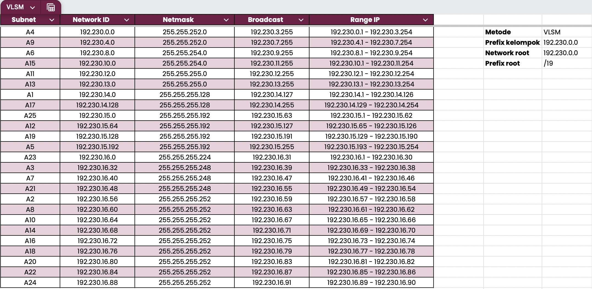

## Pengujian

### Status interface dan tabel routing

Contoh `show ip interface brief` dan `show ip route` di Wired (hub) dan Shibuya (ujung):

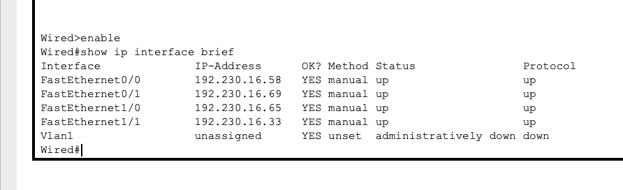
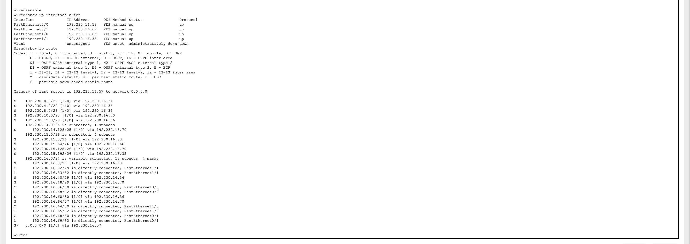
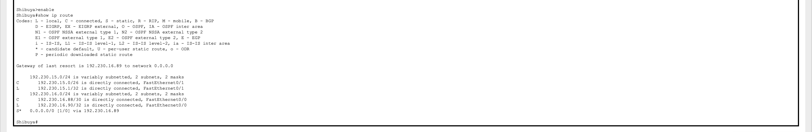

### Ping antar node


